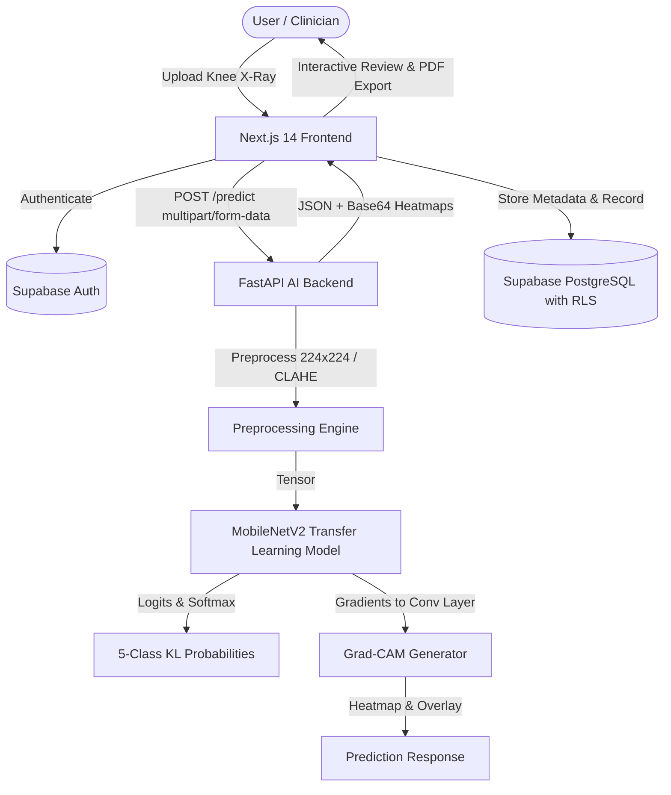

# KneeAI: Explainable Knee Osteoarthritis Grade Classification Using Deep Learning

[](https://nextjs.org/)
[](https://fastapi.tiangolo.com/)
[](https://tensorflow.org/)
[](https://arxiv.org/abs/1610.02391)
[](https://supabase.com/)
[](https://www.typescriptlang.org/)

A full-stack, research-grade medical decision-support web application that classifies knee radiograph severity across five **Kellgren–Lawrence (KL) grades** (Grade 0 to Grade 4) and provides transparent visual explanations via **Gradient-weighted Class Activation Mapping (Grad-CAM)**.

> **CRITICAL MEDICAL & RESEARCH DISCLAIMER:**  
> **KneeAI is an academic Data Science major research initiative designed strictly for educational and decision-support exploration.** The predictions, class probabilities, and Grad-CAM heatmaps generated by this platform are experimental and **DO NOT** constitute a clinical diagnosis or medical evaluation. Never alter clinical treatment based on these outputs. Always consult a certified healthcare professional or radiologist.

---

## 🎨 Color Palette & Design System

The application strictly adheres to the approved medical design palette:
- **Deep Navy:** `#16324F` (Primary branding, sidebar, high-contrast headings)
- **Medical Blue:** `#245B70` (Secondary accents, headers, subheadings)
- **Muted Medical Teal:** `#4D9690` (Active states, primary CTA buttons, badges)
- **Cool Off-White:** `#F4F7F8` (Application background, panel fills)
- **White:** `#FFFFFF` (Card surfaces, clean modals)

---

## 🏗 System Architecture



---

## 📊 Kellgren–Lawrence (KL) Staging System

| KL Grade | Radiographic Severity | Key Anatomical Criteria |
| :---: | :---: | :--- |
| **Grade 0** | **None / Normal** | Normal knee joint space width, no radiographic features of OA, absence of osteophytes. |
| **Grade 1** | **Doubtful** | Doubtful joint space narrowing and possible osteophytic lipping. |
| **Grade 2** | **Mild** | Definite osteophytes present, possible mild joint space narrowing. |
| **Grade 3** | **Moderate** | Multiple moderate osteophytes, definite joint space narrowing, some sclerosis, possible bone contour deformity. |
| **Grade 4** | **Severe** | Large osteophytes, marked joint space narrowing, severe bone sclerosis, and definite deformity of bone ends. |

---

## 📁 Repository Structure

```
Osteao proj/
├── frontend/                     # Next.js 14 App Router, TypeScript, Tailwind CSS
│   ├── src/
│   │   ├── app/
│   │   │   ├── page.tsx          # Landing page (Hero, KL scale, 5-step workflow, methodology)
│   │   │   ├── login/            # Sign in with email, password, Supabase integration
│   │   │   ├── register/         # Researcher registration
│   │   │   ├── forgot-password/  # Password recovery flow
│   │   │   ├── reset-password/   # Update password flow
│   │   │   └── dashboard/        # Dashboard layout with persistent Navy sidebar
│   │   │       ├── page.tsx      # Dashboard home with live model status and recent analyses
│   │   │       ├── analysis/     # Radiograph upload, 5-class distribution, Grad-CAM viewer
│   │   │       ├── history/      # Case audit trail with live search & grade filtering
│   │   │       ├── reports/      # PDF dossier download & inspection
│   │   │       ├── profile/      # Researcher profile settings
│   │   │       └── settings/     # Backend endpoint and CLAHE configuration
│   │   ├── components/           # Reusable UI (Button, Card, Badge, Navbar, Footer, Sidebar)
│   │   ├── context/              # AuthContext (Supabase user session management)
│   │   └── lib/                  # Supabase client and analysis persistence helpers
│   ├── tailwind.config.ts        # Custom medical palette and theme tokens
│   └── package.json
├── backend/                      # FastAPI Python Backend
│   ├── app/
│   │   ├── main.py               # Application entrypoint (/health, /ready, /predict)
│   │   ├── core/                 # Configuration, CORS, environment variables
│   │   ├── schemas/              # Pydantic schemas (PredictionResponse, HealthResponse)
│   │   └── services/             # ModelManager, forward pass, Grad-CAM generation
│   ├── tests/
│   │   ├── run_tests.py          # Automated unittest test runner
│   │   └── test_api.py           # Pytest suite
│   └── requirements.txt
├── ml/                           # Machine Learning & Explainability Pipeline
│   ├── artifacts/                # Exported model weights, training history, metrics
│   │   ├── evaluation_metrics.json
│   │   ├── model_metadata.json
│   │   └── training_history.json
│   ├── evaluation/               # Metrics calculation, confusion matrix, adjacent grade analysis
│   ├── explainability/           # Grad-CAM module computing activation gradients
│   ├── preprocessing/            # CLAHE enhancement, decoding validation, normalization
│   ├── training/                 # MobileNetV2 transfer learning & Baseline CNN architectures
│   └── scripts/                  # Dataset inspection & self-verification scripts
├── docs/                         # Documentation, SQL schema & progress tracking
│   ├── DATASET_SUMMARY.md        # Real dataset inspection report (2,264 images)
│   ├── DEVELOPMENT_PROGRESS.md   # Development phases and verification log
│   └── supabase_schema.sql       # PostgreSQL DDL with Row Level Security (RLS)
├── .github/workflows/ci.yml      # GitHub Actions CI workflow
├── .env.example                  # Environment configuration template
├── package.json                  # Root development orchestrator
└── README.md
```

---

## 🚀 Quick Start Guide

### Prerequisites
- **Node.js** v18+ (tested on v22.21.0)
- **Python** 3.10+ (tested on Python 3.12.2)
- **Git**

### 1. Unified Startup (One Command)
Start both Next.js frontend and FastAPI backend together using the root orchestrator:
```bash
npm run dev
```
This concurrently boots:
- **Frontend Web Portal:** [http://localhost:3000](http://localhost:3000)
- **FastAPI AI Backend:** [http://localhost:8000](http://localhost:8000)
- **Interactive OpenAPI Docs:** [http://localhost:8000/docs](http://localhost:8000/docs)

### 2. Run Automated Verification Tests
```bash
# Run backend test suite (5 tests covering health, readiness, error rejection, and real inference)
npm run test:backend

# Run frontend production build & typecheck
npm run test:frontend
```

---

## 🔬 Machine Learning Pipeline & Training

### Dataset Acquisition
The model is trained on the curated **Kaggle Knee Osteoarthritis Dataset with Severity**:
- **Total Usable Images:** 2,264 knee radiographs
- **Class 0 (Normal):** 1,243 images (54.9%)
- **Class 1 (Doubtful):** 374 images (16.5%)
- **Class 2 (Mild):** 403 images (17.8%)
- **Class 3 (Moderate):** 200 images (8.8%)
- **Class 4 (Severe):** 44 images (1.9%)

### Run Dataset Inspection
```bash
python ml/scripts/inspect_dataset.py
```

### Train MobileNetV2 Model
```bash
python ml/training/train.py --dataset "data set" --model mobilenetv2 --epochs 10 --batch_size 16
```
Key features of the training pipeline:
- **Depthwise Separable Convolutions:** Highly efficient feature extraction suitable for clinical edge deployment.
- **Class Imbalance Weighting:** Automatically penalizes majority-class bias using inverse frequency weighting.
- **Training-Only Augmentation:** Random rotations ($\pm 7^\circ$) and horizontal flips to prevent overfitting without corrupting validation data.
- **Early Stopping & Checkpointing:** Automatically restores the best model weights based on validation loss.

### Self-Verification Script
Run the automated end-to-end pipeline test on a real radiograph:
```bash
python ml/scripts/verify_pipeline.py
```

---

## 💡 Explainability with Grad-CAM

Gradient-weighted Class Activation Mapping (Grad-CAM) computes the gradients of the winning class score $y^c$ with respect to the feature map activations $A^k$ of the final convolutional layer:

$$\alpha_k^c = \frac{1}{Z} \sum_{i} \sum_{j} \frac{\partial y^c}{\partial A_{i,j}^k}$$

$$L^c_{\text{Grad-CAM}} = \text{ReLU}\left(\sum_k \alpha_k^c A^k\right)$$

- **Positive Activation Focus:** The $\text{ReLU}$ operation isolates features whose presence supports the predicted grade (e.g. subchondral sclerosis or joint-space narrowing).
- **Interactive UI Modes:** The results interface allows researchers to toggle between:
  1. **Side-by-Side:** Original radiograph next to Grad-CAM heatmap.
  2. **Alpha Overlay:** Semi-transparent heatmap layered directly over bone margins.
  3. **Heatmap:** Raw activation gradient map.
  4. **Original:** Full-resolution unadjusted radiograph.

---

## 🗄 Database & Supabase Authentication

KneeAI utilizes Supabase PostgreSQL with **Row Level Security (RLS)** to enforce strict patient and user data isolation:
1. Copy `.env.example` to `.env` or `.env.local` and add your project keys:
   ```env
   NEXT_PUBLIC_SUPABASE_URL=https://your-project.supabase.co
   NEXT_PUBLIC_SUPABASE_ANON_KEY=your-anon-key
   ```
2. In the Supabase SQL Editor, run `docs/supabase_schema.sql` to initialize the `profiles` and `analyses` tables with RLS policies and indexes.

> **Offline Fallback:** If Supabase credentials are not yet configured, KneeAI gracefully falls back to local session persistence so researchers can immediately test the UI and inference without interruption.

---

## ⚠️ Known Limitations
1. **Academic Prototype:** This application is built for research decision-support and educational demonstration. It is not approved by the FDA or certified as a medical device.
2. **Dataset Imbalance:** Grade 4 (Severe) represents only ~1.9% of the dataset; while class weighting mitigates bias, performance on severe deformity benefits from larger cohort multi-center data.
3. **Radiograph Quality Dependency:** Image blur, metallic implants, or non-standard projection angles may degrade feature extraction accuracy.
4. **Grad-CAM Limitations:** Heatmaps highlight feature sensitivity in convolutional kernels; they indicate correlated regions rather than absolute medical causality.

---

## 👥 Authors & Academic Context
Data Science Major Project Team  
College Capstone Initiative — "Explainable Knee Osteoarthritis Grade Classification Using Deep Learning"
